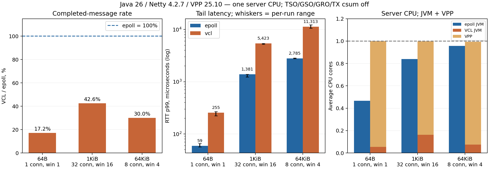

# VCL 与 Netty epoll 性能对比

**结论：本次受限环境下，当前 VCL MVP 在全部 3 个测试场景中均慢于 epoll，且服务端 Java + VPP 的合计 CPU 消耗更高。**

这反映当前实现、AF_PACKET 路径及每侧单核预算下的结果；不能推断独立 VPP 核、DPDK 或真实 NIC 场景的上限。

## 结果

数值是 3 轮独立测量的中位数；p99 列是各轮 p99 的中位数，不是将各轮样本合并后的百分位。

| 场景（帧长 / 连接数 / 每连接窗口） | transport | 消息/秒 | 单向应用 MiB/s | RTT p50 μs | RTT p99 μs | 服务端 CPU 核 | 负载端 CPU 核 |
|---|---|---:|---:|---:|---:|---:|---:|
| 64B / 1 / 1 | epoll | 50,221 | 3.06 | 16.9 | 59.2 | 0.466 | 0.498 |
| 64B / 1 / 1 | vcl | 8,626 | 0.53 | 96.6 | 255.0 | 1.000 | 0.070 |
| 1024B / 32 / 16 | epoll | 794,173 | 775.56 | 578.6 | 1,381.4 | 0.839 | 0.993 |
| 1024B / 32 / 16 | vcl | 338,338 | 330.41 | 1,298.4 | 5,423.1 | 0.998 | 0.520 |
| 65536B / 8 / 4 | epoll | 25,414 | 1,588.35 | 1,162.2 | 2,785.3 | 0.956 | 0.989 |
| 65536B / 8 / 4 | vcl | 7,619 | 476.20 | 3,588.1 | 11,313.2 | 0.996 | 0.470 |

服务端 CPU 列包含 JVM 的 user + system 时间；VCL 额外计入 VPP 进程。1.0 核表示一个逻辑核被完整占用。应用吞吐按完成回显的帧数 × 帧长计算，是单方向数值；每帧含 24B 基准头，不包含 TCP/IP/以太网头。

| 场景 | VCL 吞吐 / epoll | VCL p99 / epoll | epoll 消息/服务端 CPU 秒 | VCL 消息/服务端 CPU 秒 |
|---|---:|---:|---:|---:|
| latency-64B | 17.2% | 4.30× | 107,726 | 8,625 |
| throughput-1KiB | 42.6% | 3.93× | 946,485 | 339,167 |
| bulk-64KiB | 30.0% | 4.06× | 26,572 | 7,648 |



## 重复测量范围

下列 min–max 是 3 轮观察范围，不是置信区间。

| 场景 | transport | 消息/秒 min–max | p99 μs min–max | JVM CPU 中位数 | VPP CPU 中位数 |
|---|---|---:|---:|---:|---:|
| latency-64B | epoll | 48,028–50,688 | 56.6–65.4 | 0.466 | 0.000 |
| latency-64B | vcl | 8,530–8,913 | 222.3–267.8 | 0.054 | 0.946 |
| throughput-1KiB | epoll | 777,417–838,155 | 1,230.8–1,389.6 | 0.839 | 0.000 |
| throughput-1KiB | vcl | 336,100–359,438 | 5,222.4–5,431.3 | 0.162 | 0.836 |
| bulk-64KiB | epoll | 25,238–25,772 | 2,770.9–2,852.9 | 0.956 | 0.000 |
| bulk-64KiB | vcl | 7,420–7,709 | 10,625.0–12,296.2 | 0.076 | 0.918 |

## 测试方法与资源预算

- 时间：2026-11-13T11:45:24Z。CPU：AMD EPYC 9V74 80-Core Processor；系统：6.18.57。
- Java 26.0.2.1、Netty 4.2.7.Final、VPP/VCL 25.10-release；两端 JVM 均为 256MiB heap、G1、相同 JVM 参数。
- 容器可见 CPU 为 [0, 1, 2]，但 cgroup `cpu.max=200000 100000`，总配额为 2 核。负载端固定 CPU 0；服务端 JVM 和 VPP 共同固定 CPU 1，合计共享 1 核。
- 两个 transport 都固定 1 个服务端 I/O worker；epoll 在测试时没有 VPP 进程争用 CPU。VPP 的 polling 时间完整计入其预算。
- 公共负载端始终使用 Netty epoll。服务端业务 Handler 完全相同，均直接回显 ByteBuf，无额外业务逻辑或 server codec。
- 两端位于不同网络命名空间，始终经过同一 veth。epoll 由 Linux TCP 处理；VCL 由 VPP AF_PACKET/TCP 处理，不走 VPP 本地 cut-through。
- 双端关闭 TSO/GSO/GRO/TX checksum offload，验证开关确实为零；VPP 使用 TPACKET_V2、RX/TX 各 1024 个 2048B frame。未启用 DPDK、hugepage 或 packet trace。
- 每组预热 5 秒、计量 10 秒，重复 3 轮；轮换 epoll/VCL 的先后顺序。每组使用新客户端 JVM，同一轮/transport 的服务端 JVM 覆盖本轮全部场景。
- 固定帧请求/回显，持续补充每连接窗口；校验 magic、连接号、序列号和末字节，结束后要求所有在途请求 drain 成功。
- RTT 从客户端入队发送到完整回显被解析计时，包含排队、flush 和 TCP 往返。使用 HdrHistogram（三位有效数字）；闭环负载，无 coordinated-omission 修正。
- 服务端/VPP CPU 从 `/proc/PID/stat` 在测量窗口两端取差，包含进程所有线程；负载端用 ProcessHandle CPU 时间。内核软中断 CPU 的归属并未单独隔离。

## 解释与适用范围

- 当前单核预算下，VPP polling 与 Java I/O 线程竞争同一核，是需要考虑的资源成本；此测试不允许 VCL 免费多用一个 VPP 核。
- 负载端 CPU 接近 1 核的样本可能受生成器限制，此时测得的吞吐是该端到端配置的能力，不能当作服务端最大吞吐。
- 单个测量窗口的 cgroup throttled 时间最高为 63.4ms；详细计数保存在原始 JSON。全部应用帧校验及 drain 成功。VPP counters 记录了 Old segment / PAWS 相关计数，未进一步定位；正式测量未记录 TX ring overrun / temporary failure。
- 当前 VCL 使用标量 FFM read/write、LT readiness 及较多 interest 更新；epoll 使用成熟 native transport。CPU 分拆显示 VPP 占据大部分服务端预算，但未通过 profile 区分 polling、TCP、AF_PACKET 和调度的贡献，不能将差距直接归因于 FFM。
- AF_PACKET 包含内核路径成本；关闭 offload 是本报告的显式条件。若生产环境采用独立 VPP 核、DPDK、硬件 offload，应在目标资源预算下重新比较。
- 本轮未测新建连接/秒、固定到达率下的延迟、长期稳定性，也未测 epoll 多 worker 的最大扩展能力。

## 复现和原始数据

```bash
mvn -Pbenchmark -DskipTests package dependency:build-classpath -Dmdep.outputFile=target/benchmark-classpath
VPP_PREFIX=/path/to/vpp/usr scripts/benchmark.sh --warmup 5 --seconds 10 --repeats 3 --output target/benchmark-new
python3 scripts/summarize-benchmark.py target/benchmark-new/results.json
```

需 Java 26、Maven、VPP AF_PACKET plugin、`ip`、`taskset`、`nsenter`、`unshare`、Python 3；画图额外需要 matplotlib。仅操作脚本自建的网络空间与 VPP。输出目录必须全新，避免混合不同运行的样本。

原始数据：[JSON](benchmarks/2026-11-13/results.json)、[CSV](benchmarks/2026-11-13/results.csv)、[环境与源码 hash](benchmarks/2026-11-13/environment.json)。保留各轮 VPP counters 供检查丢包、重传和 ring 错误。
